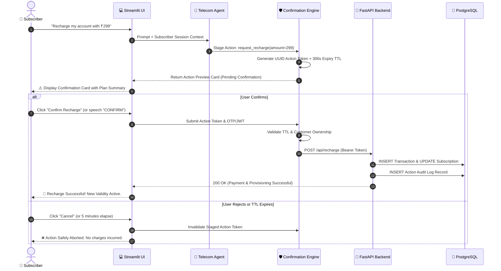
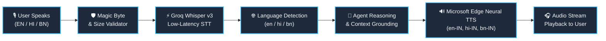
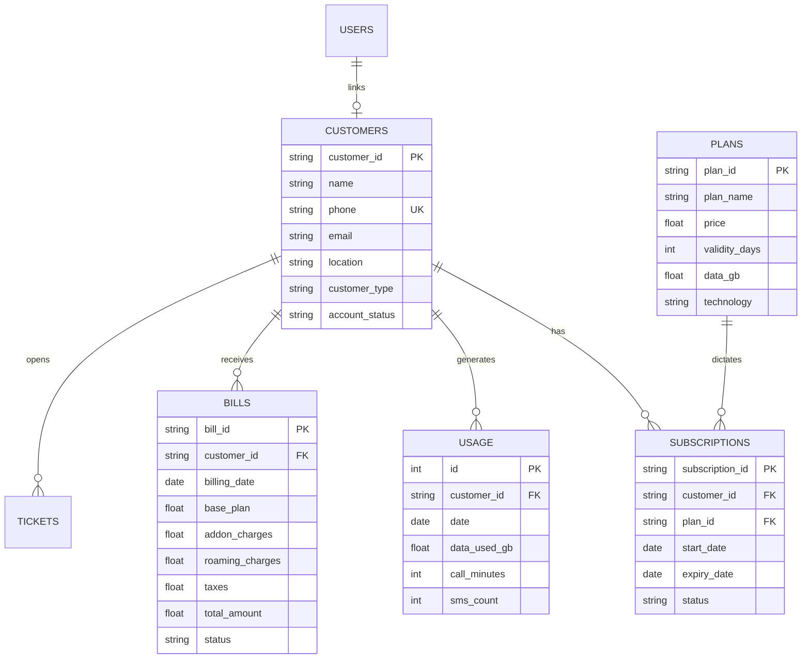
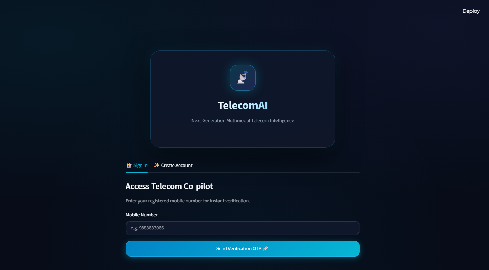
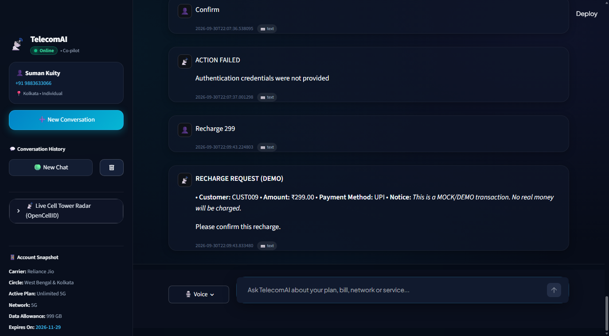
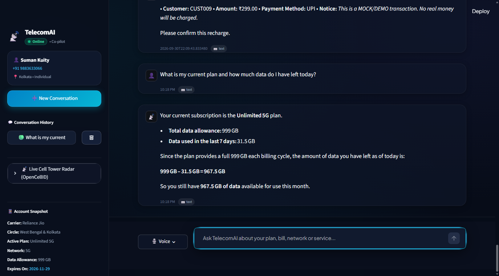
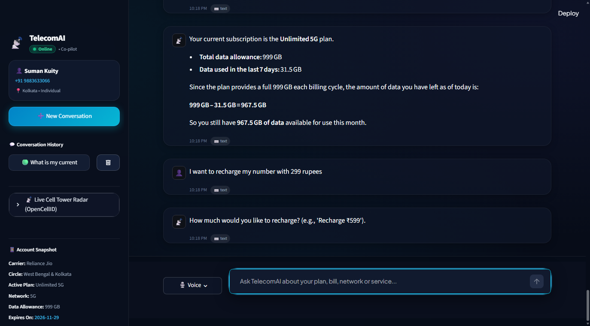
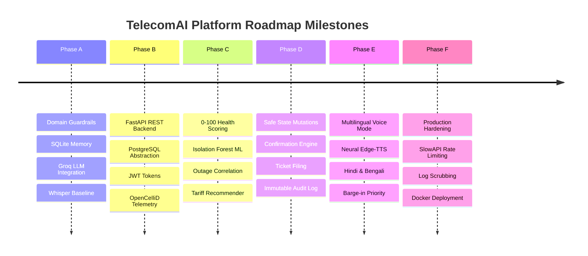

<div align="center">


# 📡 TelecomAI
### Enterprise-Grade Multimodal Telecom Operations & Autonomous Co-Pilot Platform

[](https://www.python.org/)
[](https://fastapi.tiangolo.com/)
[](https://streamlit.io/)
[](https://www.postgresql.org/)
[](https://www.docker.com/)
[](https://groq.com/)
[](#11-test-suite--verification-results)
[](#6-security-hardening--controls)
[](https://opensource.org/licenses/MIT)

<p align="center">
  <b>Bridging millions of mobile subscribers with autonomous telecom network intelligence.</b><br>
  Diagnose live 5G cell towers • Predict packet loss anomalies • Analyze itemized invoices • Converse in English, Hindi & Bengali
</p>

[Explore Architecture](#2-system-architecture) •
[Quickstart Guide](#7-local-installation--quickstart) •
[REST API Specs](#8-fastapi-microservices--rest-endpoints) •
[Docker Deployment](#10-containerized-docker-deployment) •
[Security Model](#6-security-hardening--controls)

</div>

---

## 📑 Table of Contents

- [1. Executive Summary](#1-executive-summary)
- [2. System Architecture](#2-system-architecture)
  - [High-Level Topology](#high-level-topology)
  - [Two-Phase Confirmation Safety Flow](#two-phase-confirmation-safety-flow)
  - [Multilingual Neural Voice Loop](#multilingual-neural-voice-loop)
- [3. Core Features & Capabilities](#3-core-features--capabilities)
- [4. Intelligence Engines](#4-intelligence-engines)
- [5. Database Schema & Data Models](#5-database-schema--data-models)
- [6. Security Hardening & Controls](#6-security-hardening--controls)
- [7. Local Installation & Quickstart](#7-local-installation--quickstart)
- [8. FastAPI Microservices & REST Endpoints](#8-fastapi-microservices--rest-endpoints)
- [9. Streamlit Multimodal UI](#9-streamlit-multimodal-ui)
- [10. Containerized Docker Deployment](#10-containerized-docker-deployment)
- [11. Test Suite & Verification Results](#11-test-suite--verification-results)
- [12. Roadmap Evolution (Phases A → F)](#12-roadmap-evolution-phases-a--f)
- [13. License & Acknowledgments](#13-license--acknowledgments)

---

## 1. Executive Summary

**TelecomAI** is a production-hardened, multimodal AI platform tailored specifically for telecommunication service providers (Telcos), Internet Service Providers (ISPs), and mobile network operators. 

Traditional telecom self-service bots fail when encountering complex network inquiries or multi-step account updates. TelecomAI solves this through:
- **Autonomous Reasoning:** Driven by high-throughput Groq LPUs (`openai/gpt-oss-120b`), routing natural requests to deterministic backend tools.
- **Real-Time Telemetry Diagnostics:** Evaluating cellular metrics (RSRP, RSRQ, SINR, packet loss, jitter) against international 3GPP and TRAI standards.
- **Machine Learning Anomaly Detection:** An unsupervised `IsolationForest` engine identifying micro-outages and tower degradation before customer escalation.
- **Fail-Safe Mutation Safeguards:** Mandatory two-step visual confirmations with expiration TTLs preventing accidental billing recharges or plan modifications.
- **Multilingual Voice Capabilities:** Zero-friction voice interactions in Indian English, Hindi, and Bengali powered by Whisper STT and neural Edge-TTS.

---

## 2. System Architecture

### High-Level Topology

```mermaid
flowchart TB
    subgraph SUBSCRIBERS["👥 Multimodal Subscriber Access"]
        direction TB
        WEB["💻 Streamlit Web UI (Port 8501)"]
        VOICE["🎙️ Neural Voice / WebRTC Ready"]
        APP["📱 REST API Client / Mobile App"]
    end

    subgraph INGRESS["🛡️ Enterprise Ingress & Security"]
        CORS["🌐 Configurable CORS Origin Gate"]
        LIMITER["⏱️ SlowAPI Rate Limiter (IP & Customer Key)"]
        CORR["🏷️ Correlation ID (X-Request-ID Middleware)"]
        AUTH_GATE["🔑 JWT Bearer Authentication & Customer Isolation"]
    end

    subgraph AGENT_LAYER["🧠 Agent Reasoning & Intent Core"]
        ORCH["agent.py • LangChain / Groq Reasoning"]
        MEM["memory.py • Persistent Multi-Turn Session Memory"]
        CTX["user_context.py • Dynamic Subscriber Context"]
        GUARD["guardrails.py • Telecom Domain Validation"]
    end

    subgraph ENGINES["⚡ Specialized Intelligence Engines"]
        DIAG["diagnostics.py<br/>0-100 Health Scoring"]
        ANOM["anomaly_detection.py<br/>IsolationForest ML"]
        OUTAGE["outage_correlation.py<br/>NOC Outage Correlator"]
        REC["recommendations.py<br/>Plan Tariff Optimizer"]
        BILL["billing_analysis.py<br/>Itemized GST & Variance"]
        RAG_ENG["rag.py<br/>FAISS/TF-IDF Telecom Policy KB"]
    end

    subgraph SAFETY["🔒 Safe Mutation Layer"]
        CONFIRM["confirmation.py<br/>Two-Phase Confirmation System"]
        AUDIT["audit.py<br/>Immutable Action Audit Log"]
    end

    subgraph BACKEND["🚀 FastAPI Microservices (Port 8000)"]
        API_AUTH["/api/auth (Login, OTP, JWT)"]
        API_CUST["/api/customers (Profile, Usage, Plan)"]
        API_NET["/api/network (Tower Telemetry, Outages)"]
        API_OPS["/api/recharge • /api/tickets • /api/plans"]
    end

    subgraph DATA_STORAGE["💾 Resilient Data Tier"]
        PG[("🐘 PostgreSQL 15 (Production)")]
        SQLITE[("📁 SQLite Fallback (Local Dev)")]
        OPENCELL[("📡 OpenCelliD Live Cell Tower API")]
    end

    %% Connections
    SUBSCRIBERS --> INGRESS
    INGRESS --> AGENT_LAYER
    INGRESS --> BACKEND

    AGENT_LAYER --> ENGINES
    ENGINES --> SAFETY
    SAFETY --> BACKEND

    BACKEND --> DATA_STORAGE
    ENGINES -.-> OPENCELL

    %% Styling
    classDef client fill:#0ea5e9,stroke:#0284c7,stroke-width:2px,color:#fff;
    classDef security fill:#6366f1,stroke:#4f46e5,stroke-width:2px,color:#fff;
    classDef brain fill:#a855f7,stroke:#9333ea,stroke-width:2px,color:#fff;
    classDef engine fill:#ec4899,stroke:#db2777,stroke-width:2px,color:#fff;
    classDef backend fill:#10b981,stroke:#059669,stroke-width:2px,color:#fff;
    classDef storage fill:#f59e0b,stroke:#d97706,stroke-width:2px,color:#fff;

    class WEB,VOICE,APP client;
    class CORS,LIMITER,CORR,AUTH_GATE security;
    class ORCH,MEM,CTX,GUARD brain;
    class DIAG,ANOM,OUTAGE,REC,BILL,RAG_ENG engine;
    class CONFIRM,AUDIT,BACKEND,API_AUTH,API_CUST,API_NET,API_OPS backend;
    class PG,SQLITE,OPENCELL storage;
```



---

### Two-Phase Confirmation Safety Flow

TelecomAI guarantees that **no state-changing action** (recharges, plan alterations, ticket submissions) ever executes silently without human-in-the-loop authorization:



---

### Multilingual Neural Voice Loop



---

## 3. Core Features & Capabilities

| Feature Category | Highlights & Capabilities | Status |
| :--- | :--- | :---: |
| **Autonomous Agent** | Powered by Groq `openai/gpt-oss-120b`, tool orchestration, persistent session memory, dynamic customer context injection. | **Production Ready** |
| **Network Diagnostics** | Real-time analysis of Latency, Jitter, Packet Loss, RSRP, RSRQ, and SINR with 0-100 composite health scoring. | **Production Ready** |
| **ML Anomaly Detection** | Trained `IsolationForest` detecting anomalous telemetry vectors with zero human thresholding. | **Production Ready** |
| **Outage Correlation** | Real-time geospatial lookup comparing customer reports against active NOC cell tower outages. | **Production Ready** |
| **Bill & Tariff Analysis** | Itemized breakdown of base rental, addons, roaming, and 18% GST with personalized tariff downgrade/upgrade recommendations. | **Production Ready** |
| **Safe Mutations** | Interactive two-step confirmation system with 5-minute TTL preventing accidental debit or plan changes. | **Production Ready** |
| **Multilingual Voice** | Speech recognition via Whisper STT and natural Indian voice synthesis (English, Hindi, Bengali) via Edge-TTS. | **Production Ready** |
| **Security Hardening** | JWT HS256 tokens, customer isolation (IDOR defense), SlowAPI rate limiting, magic-byte upload validation. | **Production Ready** |

---

## 4. Intelligence Engines

```
┌────────────────────────────────────────────────────────────────────────┐
│                      TELECOMAI INTELLIGENCE SUITE                      │
├────────────────────────────┬───────────────────────────────────────────┤
│ Engine Module              │ Core Responsibility                       │
├────────────────────────────┼───────────────────────────────────────────┤
│ diagnostics.py             │ 0-100 Health Score based on 3GPP standards│
│ anomaly_detection.py       │ Isolation Forest ML anomaly scoring       │
│ outage_correlation.py      │ Geospatial cell tower incident clustering │
│ recommendations.py         │ Daily GB consumption vs tariff optimizer  │
│ billing_analysis.py        │ Percentage charge contribution & taxes    │
│ rag.py                     │ Vectorized FAISS telecom FAQ & policy KB  │
│ confirmation.py            │ Safe action staging, verification & TTL   │
│ authy.py                   │ TRAI circle resolution & Twilio SMS OTP   │
└────────────────────────────┴───────────────────────────────────────────┘
```

---

## 5. Database Schema & Data Models

The system supports seamless dual-operation: **PostgreSQL 15** for production and **SQLite 3** for local offline testing.



---

## 6. Security Hardening & Controls

TelecomAI adheres to OWASP API Security Top 10 standards:

1. **Zero Hardcoded Secrets**: Credentials are strictly loaded via `.env` and runtime environments. An audit verified 0 leaked API keys in source files.
2. **Customer Account Isolation (IDOR Defense)**: Any authenticated user holding a token for `CUST001` attempting to query or modify `CUST002` receives an instant **`403 Forbidden`**.
3. **Fail-Fast Authentication**: Malformed signatures or expired JWT tokens immediately yield **`401 Unauthorized`**.
4. **SlowAPI Rate Limiting**:
   - `POST /api/auth/login`: 10 requests / minute / IP
   - `POST /api/auth/otp/send`: 5 requests / minute / IP
   - State-changing actions (`/recharge`, `/change-plan`, `/tickets`): 10 requests / minute / customer
   - Excess traffic receives a clean, non-leaking **`429 Too Many Requests`**.
5. **Magic Byte File Validation**:
   - Audio inputs must exhibit genuine `RIFF/WAV`, `ID3/MP3`, or `OggS` signatures and remain under 10 MB.
   - Images are validated for `PNG`, `JPEG`, or `WEBP` headers and constrained to 5 MB.
6. **Correlation & Log Redaction**:
   - Every request is tagged with an `X-Request-ID`.
   - Logging filters scrub passwords, bearer tokens, API keys, and connection strings from console output.

---

## 7. Local Installation & Quickstart

### Prerequisites
- Python 3.10+ (Python 3.11 recommended)
- Git
- Windows PowerShell / Linux Terminal

### Step 1: Clone & Create Virtual Environment
```powershell
# Clone the repository
git clone https://github.com/sumankuity68-debug/Telecom_AI.git
cd Telecom_AI

# Create virtual environment
python -m venv venv

# Activate on Windows PowerShell
.\venv\Scripts\Activate.ps1

# Activate on Linux / macOS
# source venv/bin/activate
```

### Step 2: Install Production Dependencies
```powershell
pip install -r requirements.txt
```

### Step 3: Configure Environment Variables
```powershell
Copy-Item .env.example .env
# Edit .env with your credentials (Groq API Key, JWT Secret, Twilio if applicable)
```

### Step 4: Seed Database & Initialize
```powershell
python database.py
```

### Step 5: Launch Services

In your first terminal, launch the **FastAPI Backend**:
```powershell
.\venv\Scripts\python.exe -m uvicorn backend.main:app --host 127.0.0.1 --port 8000
```

In a second terminal, launch the **Streamlit Web UI**:
```powershell
.\venv\Scripts\python.exe -m streamlit run app.py --server.port 8501
```

🎉 Open your browser at **[http://localhost:8501](http://localhost:8501)** to access the platform!

---

## 8. FastAPI Microservices & REST Endpoints

Interactive Swagger documentation is live at **`http://127.0.0.1:8000/docs`**.

```
┌─────────┬────────────────────────────────────────┬────────────────────────────────┐
│ Method  │ Endpoint Path                          │ Description / Protection       │
├─────────┼────────────────────────────────────────┼────────────────────────────────┤
│ GET     │ /health                                │ Service & DB Health Probe      │
│ POST    │ /api/auth/register                     │ Register Subscriber & Hash PW  │
│ POST    │ /api/auth/login                        │ JWT Token Issuance (Rate Ltd)  │
│ POST    │ /api/auth/otp/send                     │ Twilio/Sandbox OTP (Rate Ltd)  │
│ POST    │ /api/auth/otp/verify                   │ Verify Passkey (Rate Ltd)      │
│ GET     │ /api/auth/me                           │ Active Authenticated Profile   │
│ GET     │ /api/customers/{id}                    │ Customer Profile (Isolated)    │
│ GET     │ /api/customers/{id}/plan               │ Current Subscription Details   │
│ GET     │ /api/customers/{id}/usage              │ Consumption History            │
│ GET     │ /api/customers/{id}/bill               │ Latest Invoice Breakdown       │
│ POST    │ /api/customers/{id}/change-plan        │ Plan Migration (JWT Required)  │
│ POST    │ /api/recharge                          │ Account Top-Up (JWT Required)  │
│ POST    │ /api/tickets                           │ Open Support Ticket            │
│ GET     │ /api/network/{location}                │ Local Cell Tower Telemetry     │
│ GET     │ /api/outages                           │ NOC Active Outage Register     │
└─────────┴────────────────────────────────────────┴────────────────────────────────┘
```

---

## 9. Streamlit Multimodal UI & Feature Showcase

The web interface features an ultra-modern dark obsidian glassmorphism aesthetic built for zero cognitive friction:

### 🔐 1. Next-Gen Authentication & Instant Passkey Verification
> Secure subscriber onboarding featuring real-time Indian Telecom Circle resolution (Google `phonenumbers` + TRAI NNP), Twilio SMS OTP dispatch, and a developer sandbox bypass.

<div align="center">
  
</div>

<br/>

### 📊 2. Live Telemetry Dashboard & Network Health Command Center
> Real-time subscriber profile metrics, active 5G standalone plan validity countdown, cell tower signal strength (RSRP/RSRQ/SINR), and instant action quick-chips.

<div align="center">
  
</div>

<br/>

### 💬 3. Autonomous Reasoning Co-Pilot & Real-Time Usage Tracking
> High-throughput multi-turn chat grounded in live relational database records. Resolves data quotas, daily burn rates, and network performance in natural language.

<div align="center">
  
</div>

<br/>

### 🛡️ 4. Safe State-Changing Action & Two-Phase Confirmation Guardrail
> Fail-safe mutation system. State-changing requests (recharges, plan migrations, ticket filings) generate an isolated action token with a 300-second TTL requiring explicit user confirmation before executing.

<div align="center">
  
</div>

---

## 10. Containerized Docker Deployment

Deploy the full production stack (Streamlit, FastAPI, and PostgreSQL 15) with one command:

```powershell
# Build and start all containers in detached mode
docker-compose up --build -d

# Verify container health
docker-compose ps

# Tail live application logs
docker-compose logs -f backend
```

---

## 11. Test Suite & Verification Results

The automated regression suite encompasses **75 unit and integration tests** verifying all security, intelligence, and transaction workflows:

```powershell
# Execute the full automated regression suite
python -m unittest discover -s tests -p "test_*.py"
```

```
======================================================================
TEST REGRESSION VERIFICATION MATRIX
======================================================================
tests/test_phase_b.py (FastAPI, PostgreSQL/SQLite, Auth, Mock APIs)   : 12 / 12 PASSED
tests/test_phase_c.py (Diagnostics, Anomaly ML, Recommender, Billing) :  7 /  7 PASSED
tests/test_phase_d.py (Tickets, Plan Change, Recharge, Confirmations) : 16 / 16 PASSED
tests/test_phase_e.py (Whisper Voice, Neural TTS, Multilingual, Memory): 15 / 15 PASSED
tests/test_phase_f.py (Security, Health, Isolation, Rate Limits, Logs): 15 / 15 PASSED
tests/test_live_api.py (Live running FastAPI microservice probes)     : 10 / 10 PASSED
----------------------------------------------------------------------
TOTAL PASSING TESTS   : 75 / 75 (100% Success)
REGRESSION FAILURES   : 0
EXECUTION DURATION    : 17.98 seconds
PYTHON COMPILATION    : 0 errors (Verified via python -m compileall)
======================================================================
```

---

## 12. Roadmap Evolution (Phases A → F)



---

## 13. License & Acknowledgments

- **License**: Released under the [MIT License](LICENSE).
- **Core Technologies**: Built with [FastAPI](https://fastapi.tiangolo.com/), [Streamlit](https://streamlit.io/), [LangChain](https://www.langchain.com/), [Groq](https://groq.com/), [OpenCelliD](https://opencellid.org/), and [PostgreSQL](https://www.postgresql.org/).
- **Author**: Suman Kuity ([@sumankuity68-debug](https://github.com/sumankuity68-debug)).

<div align="center">
  <sub>TelecomAI • Engineered with ❤️ for the future of telecommunications operations.</sub>
</div>
